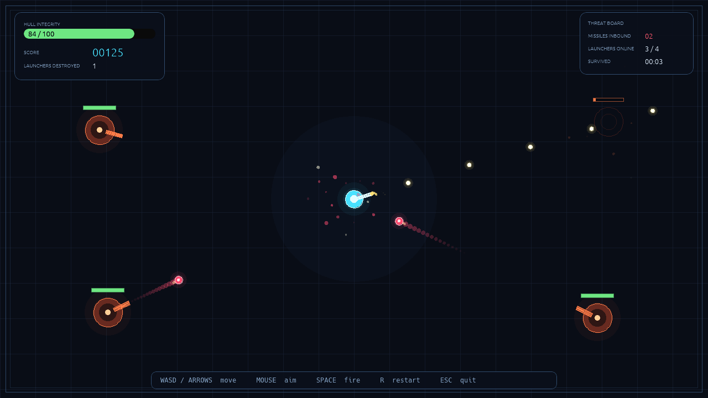

# gmid

A compact top-down arena shooter built with **Rust**, **SDL3** ([`sdl3-rs`](https://github.com/vhspace/sdl3-rs))
and **egui** ([`egui-sdl3`](https://github.com/abus-sh/egui-sdl3), Canvas backend).



You pilot a lone gunner in a neon arena. Four fixed launchers track you and
fire homing missiles. Move, aim, and shoot the missiles down - or destroy the
launchers before they respawn.

## Controls

| Input | Action |
| --- | --- |
| `W` `A` `S` `D` or arrow keys | Move |
| Mouse | Aim the gun |
| `Space` (hold) | Fire bullets |
| `R` | Restart |
| `Esc` or window close | Quit |

## Requirements

- Rust (edition 2021; developed with Rust 1.99 nightly).
- SDL3 development libraries, discoverable through `pkg-config`.
  - Debian / Ubuntu: `sudo apt install libsdl3-dev pkg-config`
  - Arch Linux: `sudo pacman -S sdl3`
  - macOS (Homebrew): `brew install sdl3`
  - Alternatively, build and install SDL3 from source.
- A working display and SDL3 renderer.

Verify SDL3 discovery with:

```sh
pkg-config --modversion sdl3
```

The crate is configured with the `sdl3/use-pkg-config` feature, so no bundled
SDL build is required.

## Build and run

```sh
cargo run --release
```

The debug build works too:

```sh
cargo run
```

## Gameplay

- The player has 100 hull integrity. A missile deals 16 damage.
- Bullets shoot down missiles and damage launchers (three hits destroy one).
- Destroyed launchers respawn after 7 seconds with a short firing delay.
- Score: **+25** per missile, **+100** per launcher.
- Taking damage grants a brief invulnerability window.
- The HUD shows hull integrity, score, destroyed launchers, incoming missiles,
  active launchers, and survival time.

## Project layout

```
src/
├── main.rs        SDL/egui bootstrap, event pump, game loop, frame pacing
├── game.rs        Game state, movement, weapons, launchers, missiles, collisions
├── entities.rs    Player, bullet, launcher, missile, and particle data
├── geometry.rs    Vector math and collision helpers
├── render.rs      SDL Canvas rendering for the game world
├── hud.rs         egui HUD and game-over overlay
└── theme.rs       Colors and gameplay tuning constants
```

## Implementation notes

- The game world is drawn directly with SDL3's `Canvas` renderer, and egui is
  painted on top for the HUD and overlays.
- All visuals are procedural (circles, lines, rectangles, particles); there are
  no external art assets.
- Movement and combat use delta-time updates with a clamped maximum step.
- Rendering targets 120 FPS with frame-time-aware sleeping.
- No automated tests are included, per the spec. The game was verified by
  building it, running it, and driving scripted play sessions under Xvfb.

The full plan, design decisions, and tuning values live in [PLAN.md](PLAN.md).

## License

MIT. See [LICENSE](LICENSE).
